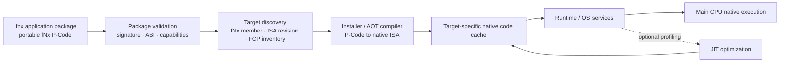
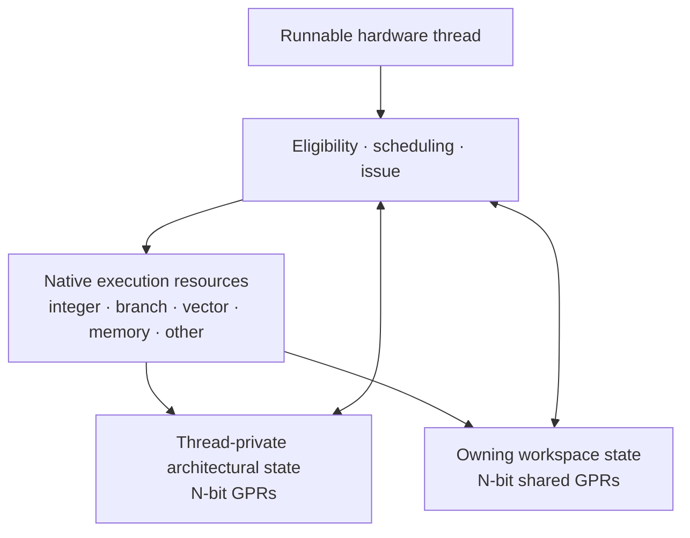
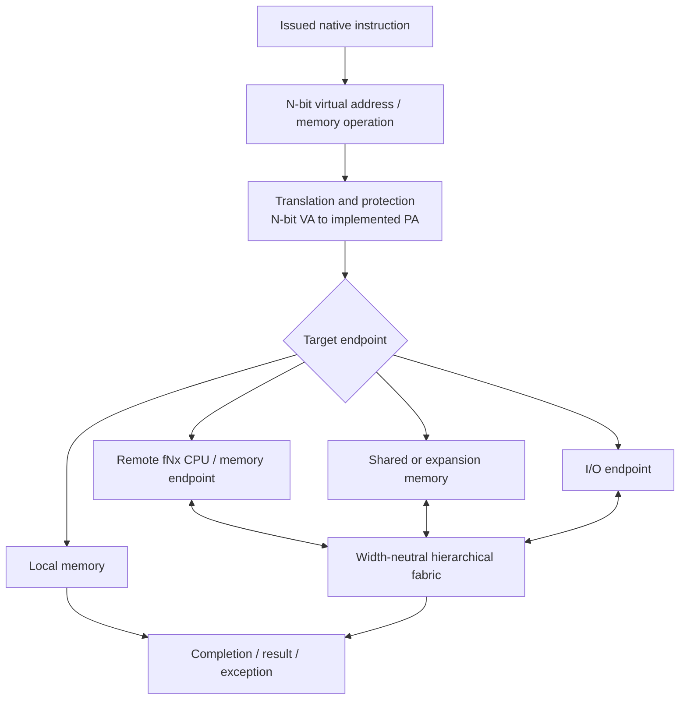

# fNx Logical Data Paths 0.2

**Date:** 2026-11-05  
**Status:** Conceptual architectural flow; memory placement and physical routing remain open

This document describes logical execution and data movement for the fNx family. For a member fNx, N is its native architectural width in bits. General-purpose registers, native arithmetic, pointers, and virtual addresses are N bits. Physical storage and links may use smaller transfer units.

## 1. Application installation and execution

P-Code is the portable application representation. Native machine code is generated for the installed fNx member and its supported capabilities. The native cache is derived and regenerable. The FCP supplies platform discovery and management; it does not compile applications or sit in the normal instruction path.

See [fNx P-Code and application compatibility](fnx-pcode-and-compatibility-0.1.md).

## 2. Thread execution and register access

Private registers belong to one thread. Workspace-shared registers belong to its owning workspace and are visible to its threads under synchronization, atomicity, and protection rules that remain to be specified.

Register counts are independent of N. The current 128-private/128-shared register counts and 128-workspace/128-thread targets are 128-bit member research assumptions, not yet family-wide invariants.

## 3. Memory and communication paths

N-bit virtual addresses are translated to the physical address space implemented by the platform. Physical address width and installed memory capacity may be smaller than N. The exact translation and protection architecture remains open.

## 4. Mixed-width fabric path

Different fNx CPU units may communicate across a common width-neutral fabric. Each CPU unit retains one native width. The fabric defines transaction lengths, ordering, completion, errors, flow control, protection, and atomic-operation capabilities independently of endpoint datapath width.

A wide local access may be split into multiple fabric transactions only when the architecture's ordering and atomicity rules permit it. Splitting does not imply atomicity.

Backplanes may be connected hierarchically. Routing, endpoint discovery, capability propagation, and fault containment must work across parent and child backplanes.

## 5. Completion, ordering, and faults

The architecture must define:
- Load/store ordering and memory consistency.
- Atomic operation scope and guarantees.
- Cacheability, coherence, and DMA interaction.
- Translation, permissions, and protection faults.
- Retry, timeout, and fabric error behavior.
- Interrupt/exception delivery with outstanding requests.
- Cancellation and precise completion.
- Ordering between shared registers, memory, and communication operations.

## 6. Simulation scope

The current scheduler and fabric simulations use 128-bit member-oriented assumptions and Java package/property names. They do not establish family-wide performance, N-bit translation behavior, cache coherence, protection, or a final ISA memory model.

- [Width-neutral fabric and backplane contract](width-neutral-fabric-and-backplane-contract-proposal-0.1.md)
- [Address-space and memory-model proposal](address-space-and-memory-model-proposal-0.1.md)
- [Exception and interrupt model proposal](exception-and-interrupt-model-proposal-0.1.md)
## Related material

- [fNx family and architectural contract](fnx-family-and-architectural-contract-0.1.md)
- [fNx P-Code and application compatibility](fnx-pcode-and-compatibility-0.1.md)
- [fNx control processor and management plane](fnx-control-and-management-plane-0.1.md)
- [Physical system block diagram](physical-system-block-diagram-0.1.md)
- [Workspace protection and shared state](workspace-protection-and-shared-state-0.2.md)
